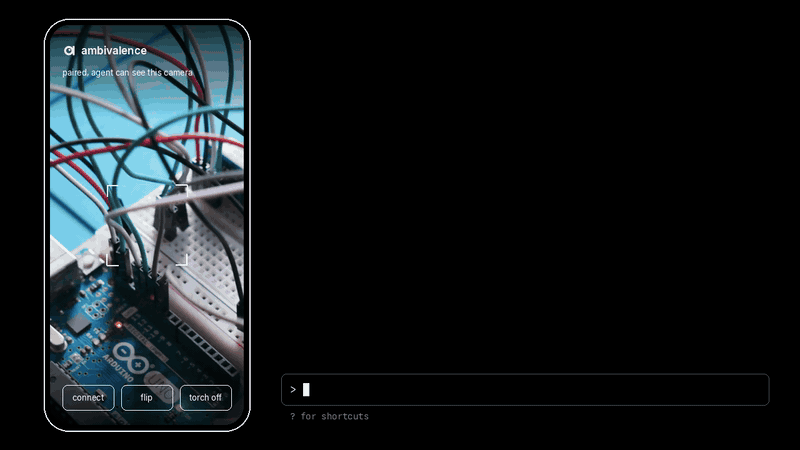
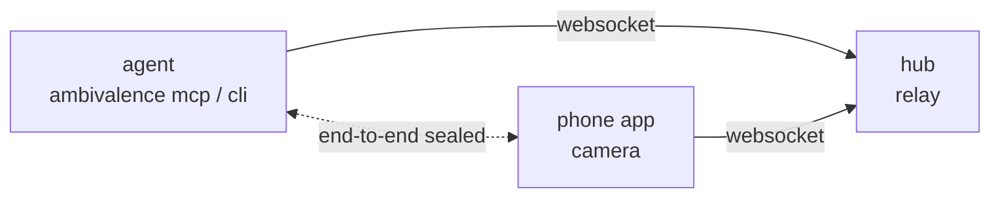

<p align="center">
  <picture>
    <source media="(prefers-color-scheme: dark)" srcset=".github/assets/ambivalence-mark-dark.svg">
    
  </picture>
</p>

<p align="center">
  <a href="https://github.com/Microck/ambivalence/releases"></a>
  <a href="https://www.npmjs.com/package/ambivalence"></a>
  <a href="https://github.com/Microck/ambivalence/actions/workflows/ci.yml"></a>
  <a href="LICENSE"></a>
</p>

<p align="center">
  
</p>

---

`ambivalence` gives your coding agent a camera: your phone. pair the phone once, and from then on the agent takes photos, switches cameras, zooms and turns on the torch over MCP or the cli, with nothing to do on the phone. the phone and the agent find each other on your wi-fi, and everything between them is end-to-end encrypted.

[protocol](docs/protocol.md) | [npm](https://www.npmjs.com/package/ambivalence) | [releases](https://github.com/Microck/ambivalence/releases) | [demo video](.github/assets/demo.mp4) | [ios build notes](apps/ios/README.md)

## why

agents can read your code but not the world next to it: the led on the board, the label on the box, the error on the other screen. `ambivalence` turns the phone already in your pocket into a camera the agent can use whenever it needs one. it sends stills, not video, because that is what vision models take: small jpegs over a websocket, which relay well and work on any network.

it is built to be left alone. you pair once with a 6-character code and a confirm tap. after that the agent reaches the phone by itself, waits for you to open the app, and keeps working through app restarts and network drops.

## quickstart

### install

with npm (downloads the release binary for your platform and checks its checksum):

```bash
npm install -g ambivalence
ambivalence version
```

or download the binary for your platform from the [latest release](https://github.com/Microck/ambivalence/releases/latest):

```bash
# linux / macos (pick linux-amd64, linux-arm64, darwin-amd64 or darwin-arm64)
curl -fsSL -o ambivalence https://github.com/Microck/ambivalence/releases/latest/download/ambivalence-linux-amd64
chmod +x ambivalence && mv ambivalence ~/.local/bin/
ambivalence version
```

or with go:

```bash
go install github.com/Microck/ambivalence/cmd/ambivalence@latest
```

every release ships `checksums.txt`:

```bash
gh release download --repo Microck/ambivalence --pattern checksums.txt
sha256sum --check --ignore-missing checksums.txt
```

### phone

- **android:** install `ambivalence.apk` from the release.
- **ios:** the release has `ambivalence-unsigned.ipa`; sign it with your own team to sideload (see [apps/ios/README.md](apps/ios/README.md)).
- **no app:** run the hub with `--tunnel` and open the printed https url in the phone browser.

### connect your agent

add the mcp server to your agent:

```json
{
  "mcpServers": {
    "ambivalence": {
      "command": "ambivalence",
      "args": ["mcp"]
    }
  }
}
```

open the app on the same wi-fi. it finds the agent's hub by itself and shows a code. tell your agent the code once:

> connect to my phone camera, the code is K9RBCY

both sides then show the same confirmation code. check they match and tap confirm on the phone. that is the only time you touch the phone. from then on just ask:

> take a photo of the board and tell me which led is on

without mcp, the cli does the same:

```bash
ambivalence hub &                 # the mcp server runs this for you
ambivalence pair K9RBCY           # once per phone
ambivalence capture -o shot.jpg   # any time after
```

## how it works



- the agent and the phone both dial out to a hub, so the phone needs no open ports. the hub only relays and never sees a secret.
- hubs advertise `_ambivalence._tcp` over mdns with their wi-fi addresses, so the app finds them with nothing typed. on networks that block this (guest or office wi-fi), scan the qr code that `ambivalence hub --tunnel` prints.
- pairing is a p-256 key exchange checked by the matching confirmation codes, so a hub in the middle cannot slip in its own key. both sides keep the resulting link key.
- every session, the phone and the agent prove the key to each other. then every request, reply and frame is aes-256-gcm sealed in strict order: a rogue hub can refuse to relay, but it cannot see frames, inject or replay requests, or forge images.
- the phone connects to its saved hub and any hubs it discovers (up to 4), and the agent reaches it on whichever one it uses.

the full wire format is in [docs/protocol.md](docs/protocol.md).

### where the link key lives

| side | storage |
| --- | --- |
| agent | `$XDG_CONFIG_HOME/ambivalence/config.json`, mode `0600` |
| ios app | keychain, this device only |
| android app | app-private shared preferences (not the hardware keystore) |
| browser host | `localStorage` of the hub's origin |

the browser host is javascript served by the hub, so it trusts that hub. use it only through a hub you run. the apps have no such dependency.

## cli

```text
ambivalence hub [--listen 0.0.0.0:7842] [--tunnel | --public https://…]
ambivalence mcp [--listen …] [--hub ws://…] [--public-hub wss://…]
ambivalence pair CODE
ambivalence capture [-o shot.jpg] [--quality 80] [--max-width 1280]
ambivalence cameras | status | torch on|off | switch front|back | zoom 2
ambivalence host fake [--state phone.json]
```

env: `AMBIVALENCE_HUB`, `AMBIVALENCE_LISTEN`, `AMBIVALENCE_PUBLIC_HUB`.

mcp tools: `camera_status`, `camera_connect`, `camera_disconnect`, `camera_capture` (returns the jpeg to the model), `camera_list`, `camera_switch`, `camera_torch`, `camera_zoom`.

## build

```bash
go test ./...
go build -o bin/ambivalence ./cmd/ambivalence
bash scripts/e2e-fake.sh   # pair, restart and reconnect against a fake phone
```

| piece | stack |
| --- | --- |
| cli, mcp server, hub | go, one static binary |
| android app | kotlin, camerax. `scripts/build-apk.sh` (docker + android sdk 35) |
| ios app | swift, avfoundation, cryptokit. xcodegen + xcode, see [apps/ios/README.md](apps/ios/README.md) |
| browser host | one html file served by the hub at `/` |

`scripts/browserstack-smoke.py` runs the whole flow on a real phone on browserstack: it pairs, compares the confirmation codes, taps confirm, captures, toggles the torch, switches cameras, restarts the app and captures again with no code.

## license

[mit](LICENSE)
