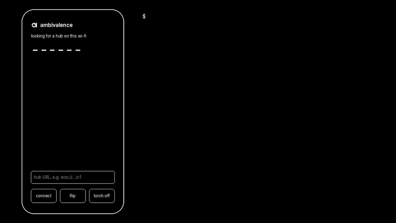
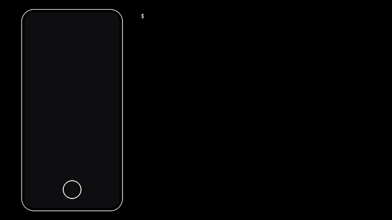
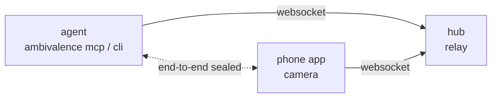

<p align="center">
  <picture>
    <source media="(prefers-color-scheme: dark)" srcset=".github/assets/ambivalence-mark-dark.svg">
    
  </picture>
</p>

<p align="center">
  <a href="https://github.com/Microck/ambivalence/releases"></a>
  <a href="https://www.npmjs.com/package/ambivalence"></a>
  <a href="https://github.com/Microck/ambivalence/actions/workflows/ci.yml"></a>
  <a href="LICENSE"></a>
</p>

<p align="center">
  
</p>

---

`ambivalence` lets your coding agent use your phone as a camera. you pair the phone once. after that the agent takes photos, switches between the front and back camera, zooms and turns on the torch through MCP or the cli, and you don't touch the phone again. on the same wi-fi the phone finds the agent by itself. everything between the phone and the agent is end-to-end encrypted.

[protocol](docs/protocol.md) | [npm](https://www.npmjs.com/package/ambivalence) | [releases](https://github.com/Microck/ambivalence/releases) | [demo video](.github/assets/demo.mp4) | [ios build notes](apps/ios/README.md)

## why

your agent can read your code, but it can't see the board on your desk, the label on a box or the error on another screen. `ambivalence` gives it the phone in your pocket. it sends still photos, not video, because vision models take stills. each photo is one jpeg over a websocket, so it works on slow networks too.

after the first pairing there is nothing to do on the phone. open the app and ask the agent. if the app is closed when the agent asks, the agent waits up to 30 seconds for you to open it. the link survives app restarts and network drops.

## requirements

| part | needs |
| --- | --- |
| agent side | linux, macos or windows, amd64 or arm64. node 18+ if you install with npm |
| android | android 8.0 or newer |
| ios | ios 17 or newer, and an apple developer team to sign the app |
| browser | any phone browser with camera access, over https |
| optional | [cloudflared](https://developers.cloudflare.com/cloudflare-one/connections/connect-networks/downloads/) for `--tunnel`, [tailscale](https://tailscale.com) for access from anywhere |

## install

### agent side

with npm:

```bash
npm install -g ambivalence
ambivalence version
```

the package downloads the release binary for your platform and checks it against the release's `checksums.txt`. if your npm runs with install scripts disabled, the download happens on the first `ambivalence` command instead.

or download a binary from the [latest release](https://github.com/Microck/ambivalence/releases/latest). the names are `ambivalence-<os>-<arch>`, for example `ambivalence-darwin-arm64` or `ambivalence-windows-amd64.exe`:

```bash
curl -fsSL -o ambivalence https://github.com/Microck/ambivalence/releases/latest/download/ambivalence-linux-amd64
chmod +x ambivalence && mv ambivalence ~/.local/bin/
```

or build it with go 1.26 or newer:

```bash
go install github.com/Microck/ambivalence/cmd/ambivalence@latest
```

to check a downloaded binary by hand:

```bash
gh release download --repo Microck/ambivalence --pattern checksums.txt
sha256sum --check --ignore-missing checksums.txt
```

### phone

android: install `ambivalence.apk` from the release. allow installs from unknown sources when android asks. the app asks for camera access on first launch.

ios: the release has `ambivalence-unsigned.ipa`. sign it with your own team before you install it, as [apps/ios/README.md](apps/ios/README.md) describes. on first launch, allow camera access and local network access. without local network access the app cannot find the agent on your wi-fi.

no app: any phone browser works. see [from a browser](#from-a-browser).

## connect your agent

### 1. add the mcp server

claude code:

```bash
claude mcp add ambivalence -- ambivalence mcp
```

codex cli, in `~/.codex/config.toml`:

```toml
[mcp_servers.ambivalence]
command = "ambivalence"
args = ["mcp"]
```

any other mcp client:

```json
{
  "mcpServers": {
    "ambivalence": {
      "command": "ambivalence",
      "args": ["mcp"]
    }
  }
}
```

`ambivalence mcp` starts a hub on port 7842 inside the same process. you don't need to run `ambivalence hub` next to it.

### 2. pair once

open the app on the same wi-fi as the agent's computer. the app finds the hub and shows a 6-character code. give the code to your agent:

> connect to my phone camera, the code is K9RBCY

the agent and the phone then both show a second code. if the two match, tap confirm on the phone. if they differ, tap cancel, because something between them is interfering.

### 3. use it

from then on, ask the agent whenever it needs to see something:

> take a photo of the board and tell me which led is on

the mcp tools are:

| tool | does |
| --- | --- |
| `camera_capture` | takes a photo and returns the jpeg to the model |
| `camera_connect` | pairs with a code, or reconnects to the linked phone |
| `camera_switch` | selects an exact camera ID, or the `front` or `back` default |
| `camera_torch` | turns the torch on or off |
| `camera_zoom` | sets the zoom factor |
| `camera_list` | lists selectable lenses, zoom ranges and supported manual controls |
| `camera_configure` | sets focus, shutter/ISO, exposure bias and white balance where supported |
| `camera_status` | shows whether the phone is linked and online |
| `camera_disconnect` | closes the current session; the link stays saved |

See [lens selection and manual controls](docs/camera-controls.md) for capability discovery, settings and platform limits.

### without mcp

the cli does the same from a terminal:

```bash
ambivalence hub &                         # skip this if ambivalence mcp is running
ambivalence pair K9RBCY                   # once per phone
ambivalence capture -o shot.jpg           # any time after
ambivalence torch on
ambivalence cameras                       # discover exact lens IDs and capabilities
ambivalence switch front
ambivalence configure '{"focusMode":"manual","focusPosition":0}'
ambivalence zoom 2
```

## reach the phone from other networks

on the same wi-fi you need nothing extra. hubs announce themselves over mdns, and the app connects to every hub it finds. guest and office networks often block devices from seeing each other. on those, and away from home, use one of the options below. you only set this up once, because the app saves the hub address.

### tailscale

if the agent's computer and the phone are both on your tailnet, the phone can reach the hub from anywhere.

1. install tailscale on the phone and sign in to the same tailnet.
2. find the computer's tailnet address with `tailscale ip -4`, or use its magicdns name, such as `my-laptop.tail1234.ts.net`.
3. in the app, type the hub url into the field at the bottom and tap connect:

   ```text
   ws://my-laptop.tail1234.ts.net:7842/v1
   ```

4. pair with the code as above.

<p align="center"></p>

the hub listens on all interfaces by default (`0.0.0.0:7842`), so tailscale can reach it with no further setup. mdns does not cross the tailnet, which is why you type the address once. the app keeps this hub and also connects to hubs it finds on the local wi-fi.

for the browser page over tailscale you need https. tailscale serve provides it if https certificates are enabled for your tailnet:

```bash
tailscale serve --bg 7842
ambivalence hub --public https://my-laptop.tail1234.ts.net
```

the second command prints a qr code that opens the app already connected, and the https url for the browser.

### cloudflare quick tunnel

```bash
ambivalence hub --tunnel
```

this needs `cloudflared` on your path. it prints a public `https://….trycloudflare.com` url and a qr code. scan the qr code with the phone's camera to open the app connected to the hub, or open the url in the phone's browser. the url changes every time you start the tunnel, so the phone needs the new one after a restart.

<p align="center"></p>

### your own https proxy

if the hub already sits behind your own https reverse proxy, print the qr code with:

```bash
ambivalence hub --public https://camera.example.com
```

the proxy must pass websocket upgrades through on the `/v1` path.

### using a tunnel with mcp

`ambivalence mcp` runs its own hub, and two hubs cannot share port 7842. to put the mcp server behind a tunnel, run the hub yourself and start the mcp server without one:

```bash
ambivalence hub --tunnel
```

```json
{ "command": "ambivalence", "args": ["mcp", "--no-hub"] }
```

with `--no-hub`, the mcp server connects to `ws://127.0.0.1:7842/v1`. set `--hub` or `AMBIVALENCE_HUB` to use a hub on another machine.

## from a browser

the hub serves a camera page at `/`, so a phone can use its browser instead of the app. browsers only allow the camera on https pages, so open the page through one of the https options above (`--tunnel`, tailscale serve or your own proxy). allow camera access, and pair with the code it shows.

the browser page has three limits. it cannot find hubs on the wi-fi. it stops when you close the tab, though it reconnects by itself after a network drop while the tab is open. and it runs javascript that the hub serves, so a hub you don't control could read its link key. use the browser page only with a hub you run. the apps don't have this problem.

## troubleshooting

the app shows no code: the phone and computer probably can't see each other. check that both are on the same network, that ios has local network access for the app, and that the computer's firewall allows tcp port 7842 and mdns (udp 5353). otherwise use [tailscale or a tunnel](#reach-the-phone-from-other-networks).

the agent says `linked phone is offline`: open the app. the agent waits up to 30 seconds, then gives up.

the agent says `phone is busy with another agent connection`: another agent session holds the phone. close it, or wait for the phone to drop it, which takes up to a minute after that agent dies.

the agent says the phone rejected its link: the phone was paired with another agent since. a phone keeps one link at a time, so pair this agent again with the code on the phone.

the two confirmation codes differ: tap cancel and pair again. a mismatch means something between the phone and the agent changed the key exchange.

to unlink, pair again, or delete the `device` and `key` fields from the agent's config file.

## how it works



both the agent and the phone open a connection to a hub, so the phone needs no open ports. the hub passes messages between them and never sees a secret.

pairing runs a p-256 key exchange. both sides show a code derived from that exchange, and the user checks that they match. a hub in the middle that swapped in its own keys would produce different codes. both sides store the resulting link key.

in every later session, the phone and the agent each prove they hold the key. after that, aes-256-gcm encrypts every request, reply and photo, and each message must arrive in exact order. a rogue hub can refuse to relay, but it cannot see photos, send its own requests, replay old ones or swap images.

the phone connects to its saved hub and to up to 4 hubs it discovers. the agent reaches it through whichever hub the agent uses.

[docs/protocol.md](docs/protocol.md) has the full wire format.

### where the link key lives

| side | storage |
| --- | --- |
| agent | `$XDG_CONFIG_HOME/ambivalence/config.json` (usually `~/.config/ambivalence/config.json`), mode `0600` |
| ios app | keychain, this device only |
| android app | app-private shared preferences, not the hardware keystore |
| browser page | `localStorage` of the hub's origin |

## cli reference

```text
ambivalence hub [--listen 0.0.0.0:7842] [--tunnel | --public https://…]
ambivalence mcp [--listen 0.0.0.0:7842] [--hub ws://…] [--no-hub] [--public-hub wss://…]
ambivalence pair CODE [--hub ws://…] [--timeout 2m]
ambivalence capture [-o shot.jpg] [--quality 80] [--max-width 1280]
ambivalence status | cameras
ambivalence torch on|off
ambivalence switch front|back
ambivalence zoom FACTOR
ambivalence host fake [--state phone.json]   # a test phone that serves a test pattern
ambivalence version
```

| variable | meaning |
| --- | --- |
| `AMBIVALENCE_HUB` | hub url the agent connects to, default `ws://127.0.0.1:7842/v1` |
| `AMBIVALENCE_LISTEN` | address the hub listens on, default `0.0.0.0:7842` |
| `AMBIVALENCE_PUBLIC_HUB` | public `wss://` url that `camera_status` reports to the agent |

## build from source

```bash
go test ./...
go build -o bin/ambivalence ./cmd/ambivalence
bash scripts/e2e-fake.sh   # pairs a fake phone, restarts it and reconnects
```

| part | stack | build |
| --- | --- | --- |
| cli, mcp server, hub | go | one static binary |
| android app | kotlin, camerax | `scripts/build-apk.sh` (docker and android sdk 35) |
| ios app | swift, avfoundation, cryptokit | xcodegen and xcode, see [apps/ios/README.md](apps/ios/README.md) |
| browser page | html and javascript | served by the hub from `internal/hub/web/index.html` |

`scripts/browserstack-smoke.py` runs the whole flow on a real phone on browserstack. it pairs, checks that the confirmation codes match, taps confirm, takes photos, toggles the torch, switches cameras, restarts the app and takes another photo without a code.

## license

[mit](LICENSE)

## deterministic browser flow tests

The root development-only `package.json` is separate from the published `npm/`
package. Run `npm ci`, `npx e2e-web install chromium`, and `npm run test:e2e`.
The tester-army/e2e suite uses no model calls and simulates camera denial rather
than requesting access to real hardware. It covers the host controls, invalid
hub addresses, mobile layout and recoverable errors. Existing Go tests,
`scripts/e2e-fake.sh` and browser-control unit tests cover separate contracts.
Physical camera quality, hardware constraints and native mobile acceptance still
require device testing; a simulated browser pass does not establish those.
